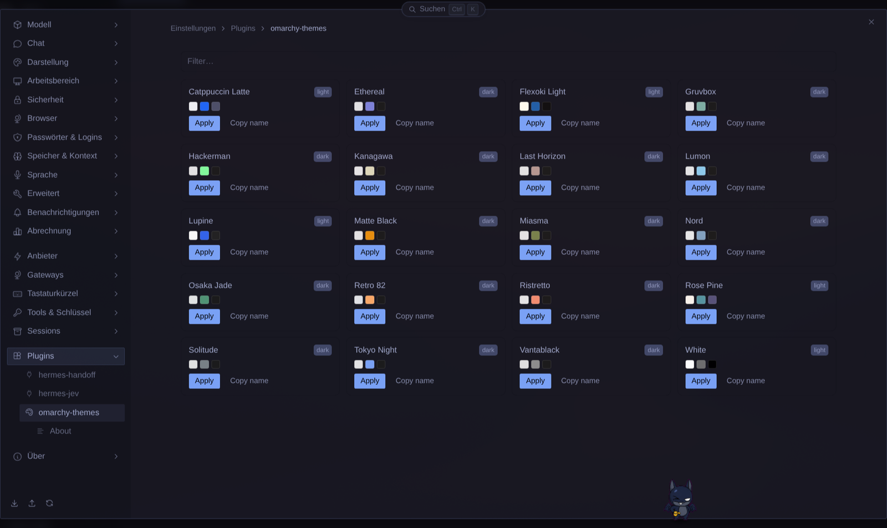
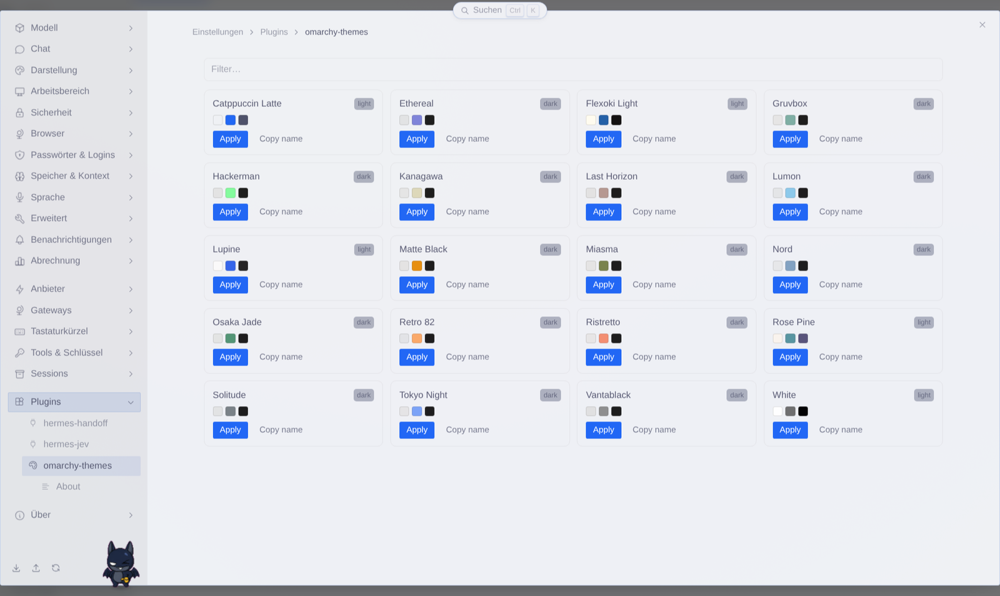
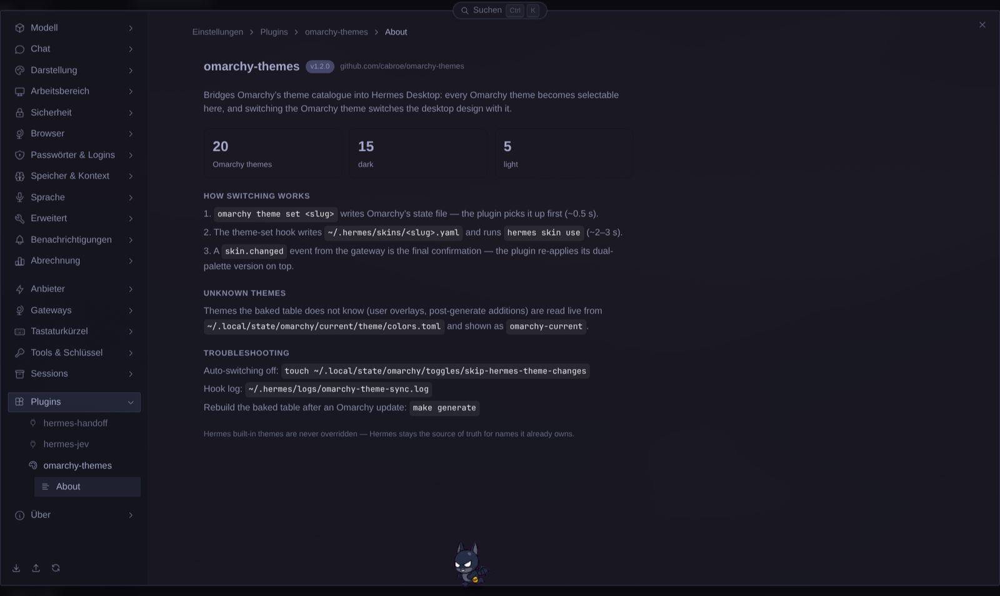

<div align="center">

# 🎨 omarchy-themes

**Omarchy-Paletten, Hermes-nativ — ein `theme set`, Desktop-Picker + CLI + TUI wechseln synchron.**

[](https://github.com/cabroe/omarchy-themes/actions/workflows/ci.yml)

**Deutsch** · [English](README.md)

</div>

---

## Über

Omarchy-Farbschemata als Hermes-Desktop-Themes und CLI/TUI-Skins

**Homepage:** [cabroe.github.io/omarchy-themes](https://cabroe.github.io/omarchy-themes/) · Upstream: [omarchy.org](https://omarchy.org)

---

## Inhalt

- [Über](#über)
- [🧩 Komponenten](#-komponenten)
- [📦 Installation & Benutzung](#-installation--benutzung)
- [🔄 Themes aktualisieren](#-themes-aktualisieren)
- [🧪 Tests](#-tests)
- [📁 Projektstruktur](#-projektstruktur)
- [🔬 Implementation Notes](#-implementation-notes)
- [🗺 Farb-Mapping](#-farb-mapping)
- [📄 Lizenz](#-lizenz)

---

## 🧩 Komponenten

- **Desktop-Plugin** (`desktop/plugin.js`) — Bridge zwischen Omarchy-Themes und Hermes Desktop: erkennt jedes Omarchy-Theme, macht es im Theme-Picker, in ⌘K und auf der Settings-Seite verfügbar, und schaltet das aktive Hermes-Desktop-Design automatisch um, sobald das Omarchy-Theme wechselt. User-Themes, die nicht in der Baked-Table stehen, werden zusätzlich live aus `current/theme/colors.toml` als `omarchy-current` registriert.
- **Theme-Sync-Hook** (`hooks/hermes-skin-sync.sh`) — Läuft bei `omarchy theme set <slug>`, prüft den `skip-hermes-theme-changes`-Toggle (Exit 0 ohne Side-Effects wenn aktiv), schreibt `~/.hermes/skins/<slug>.yaml` und aktiviert den Hermes-Skin.
- **Generator** (`scripts/generate-themes.py`) — Liest `colors.toml`-Dateien und schreibt die Theme-Tabelle im Plugin neu nach Omarchy-Updates. Default = System-Themes; `--include-user` backt zusätzlich User-Themes.

Die Settings-Seite mit allen Omarchy-Themes als Karten — hier im Theme Tokyo Night:



Ein helles Theme färbt den Desktop genauso um — hier Catppuccin Latte:



Die About-Seite erklärt den Sync-Mechanismus und zählt die Themes auf:



---

## 📦 Installation & Benutzung

`hermes plugins install https://github.com/cabroe/omarchy-themes`, dann **⌘K → „Reload desktop plugins"**. Einmal aktivieren: Settings → Capabilities → Plugins → omarchy-themes → Toggle.

Ohne Terminal: Settings → Capabilities → Plugins → *Von Git installieren*, `https://github.com/cabroe/omarchy-themes` einfügen, *Repository prüfen*, *Installieren* — die App installiert und aktiviert in einem Schritt.

**Optional: Terminal-Skin (Hook).** Die Desktop-Themes funktionieren ohne diesen Schritt. `omarchy theme set` färbt auch die Hermes-CLI/TUI um, und diese Hälfte ist ein Hook: `~/.config/omarchy/hooks/theme-set.d/hermes-skin-sync.sh`. Auf der Plugin-Seite (Settings → Capabilities → Plugins → `omarchy-themes`) sitzt über den Theme-Karten die Zeile *Terminal-Skin (Hook)* — *Installieren* schreibt die Datei, *Entfernen* entfernt sie wieder. Aus einem Checkout erledigt `make install-hook` dasselbe.

**Deinstallation:** `hermes plugins remove omarchy-themes`, dann Hermes Desktop neu starten. Der Befehl löscht das Plugin-Verzeichnis und entfernt seine Einträge aus der Hermes-Config (Plugin-Liste, Freigaben) — manuell nacharbeiten musst du nichts. `display.skin` zeigt danach weiter auf den zuletzt aktiven Omarchy-Skin; `hermes skin use default` holt eine eingebaute Palette zurück.

**Deinstallation ohne Terminal:** Settings → Capabilities → Plugins → Papierkorb in der Zeile `omarchy-themes` → *Deinstallieren*. Die App löscht den Ordner und entlädt das Plugin sofort, ein Neustart ist dafür nicht nötig.

**Ein Rest bleibt von selbst:** `hermes plugins remove` löscht das Plugin-Verzeichnis, aber nicht den Hook unter `~/.config/omarchy/hooks/theme-set.d/hermes-skin-sync.sh`. Er bleibt liegen und setzt bei jedem `omarchy theme set` weiter den CLI/TUI-Skin. Entfernen mit *Entfernen* auf der Plugin-Seite, bevor du deinstallierst, oder danach mit `make uninstall-hook` (Alias: `make uninstall`) aus einem Checkout — das Ziel ist ein einzelnes `rm -f` auf diesen Pfad.

**Reste nach der Deinstallation:** Skin-Dateien unter `~/.hermes/skins/<slug>.yaml` und — falls gesetzt — der Auto-Sync-Toggle unter `~/.local/state/omarchy/toggles/`; löschen, wenn du sie nicht mehr brauchst.

**Entwicklung:** Node ≥ 22, Python ≥ 3.11, `shellcheck`. `make check` = Lint + Tests + `pages-check` (Drift-Gate gegen die Homepage; ohne gh-pages-Checkout ein sichtbarer SKIP); `make install-githooks` aktiviert Pre-push-`generate-check`-Guard (blockt den Push bei Drift — kein Auto-Commit mehr).

**Was du bekommst:**
- Jedes Omarchy-Theme erscheint als `omarchy-<slug>` im Picker, in ⌘K (`Apply Omarchy Theme: <Name>`) und in der Settings-Kartenansicht mit Swatches/Filter/*Apply*. `catppuccin` und `everforest` kollidieren mit Hermes-Built-ins und werden im Picker übersprungen (Hermes ist Source of Truth).
- `omarchy theme set nord` wechselt Desktop-Theme **und** Hell/Dunkel-Modus; Hook synchronisiert CLI/TUI-Skin (~3 s Verzögerung, 15-s-No-Op-Fenster).
- `~/.local/state/omarchy/toggles/skip-hermes-theme-changes` stoppt Auto-Switching vollständig: Hook prüft den Toggle, schreibt keinen Skin, beendet mit Exit 0; Plugin stellt die vor dem Toggle gezeigte Palette wieder her. Picker und ⌘K funktionieren weiter (sie sind nutzer-initiiert und umgehen den Toggle).
- Jedes Theme liefert **beide** Paletten + **beide** Terminal-Paletten + Typography — Light/Dark-Wechsel färbt die ganze UI neu. Beide Paletten teilen Marken-`accent`/`primary`/`ring`; Gegenpalette wird auto-synthetisiert (Rec.709-Luma ≥ 0,5-Kontrast).
- Unbekannte Themes (User-installiert oder neuer als `make generate`): Plugin liest `~/.local/state/omarchy/current/theme/colors.toml` und registriert **einen** `omarchy-current`-Fallback.

---

## 🔄 Themes aktualisieren

Nach einem Omarchy-Update: `make generate` (`HOST=<ssh-Host>` liest per SSH) baut die Baked-Table aus den System-Themes neu (Default — matched den committeten Stand); `make generate-system` ist ein Alias und wird vom `regen-themes`-Workflow verwendet; `make generate-check` ist die Drift-Prüfung (blockt den Push). Eigene Themes backen: `python3 scripts/generate-themes.py --include-user` oder `make generate SYSTEM=…`. Themes, die nicht in der Baked-Table stehen, werden weiterhin live als `omarchy-current` aus `current/theme/colors.toml` registriert. Generator ersetzt nur den `// BEGIN GENERATED THEMES` … `// END GENERATED THEMES`-Block, ist deterministisch, löst Themes ohne `colors.toml` über `omarchy-theme-colors-from-alacritty` / `omarchy-theme-color` auf.

---

## 🧪 Tests

```bash
make check    # = lint + test + pages-check
make test     # node tests/smoke.mjs && sh tests/hook.sh
make pages-check  # Drift-Gate gegen die Homepage (PAGES_DIR=<checkout>; ohne Checkout sichtbarer SKIP)
make lint     # node --check + py_compile + shellcheck
```

- **`tests/smoke.mjs`** — Plugin lädt, registriert Themes/Befehle/Settings, Farben gültig, Luma/Marke/Präfix erzwungen, CLI→Desktop-Sync abgedeckt.
- **`tests/hook.sh`** — Skin-YAML (22 Keys, 3-stelliges Hex), Skip bei unbekannt, Exit 0 bei Fehler, Fallback auf Omarchy-erzeugte `colors.toml`.
- **`tests/theme-switch-smoke.sh`** — Live `omarchy theme set` per SSH (`make theme-smoke HOST=omarchy`). Mutiert User-State; nicht in `make check`.

CI: vier Workflows. `ci.yml` (Lint + Tests auf Push/PR, manuelle `workflow_dispatch`). `pages-consistency.yml` erzwingt das Drift-Gate zwischen `main` und `gh-pages` (checkt beide Branches getrennt aus, läuft GitHub-hosted, schlägt bei Drift fehl). `live-theme-smoke.yml` führt Smoke auf Self-hosted-omarchy-Runner aus (manuell `workflow_dispatch`, sonntags 04:00 UTC, `push` auf `main` wenn Smoke/Hook/Workflow ändern). `regen-themes.yml` regeneriert die Baked-Table wöchentlich (montags 04:00 UTC) und öffnet einen PR wenn Drift entstanden ist; manuell via `workflow_dispatch`. Dedizierte Label-gepinnte Runner; vor Trigger starten, danach stoppen.

---

## 📁 Projektstruktur

```
omarchy-themes/
├── desktop/plugin.js         # Hermes-Desktop-Plugin (plain ESM)
├── hooks/hermes-skin-sync.sh # Omarchy-theme-set-Hook → Hermes CLI/TUI-Skin
├── scripts/generate-themes.py  # colors.toml → Theme-Tabelle in plugin.js
├── tests/{smoke.mjs,hook.sh,theme-switch-smoke.sh,stubs/}
├── .github/workflows/        # ci.yml, pages-consistency.yml, live-theme-smoke.yml, regen-themes.yml
├── .githooks/pre-push        # generate-check-Guard
└── Makefile
```

Install-Ziel: `~/.hermes/desktop-plugins/omarchy-themes/plugin.js` (auto), `~/.config/omarchy/hooks/theme-set.d/hermes-skin-sync.sh` (manuell `make install-hook`).

---

## 🔬 Implementation Notes

Omarchys `lighter_background` / `darker_background` bleiben auf der falschen Seite des Renderer-Luma-Schwellwerts (0,5), also flippt der UI-Modus nie. Plugin synthetisiert fehlende Palette mit `mixHex(c.background, '#000'|'#fff', 0.88)` (siehe `SURFACE_MIX_AMOUNT` / `ACCENT_TEXT_LUMA` in `desktop/plugin.js`). Marken-Identität bleibt: `accent`/`primary`/`ring`/`midground`/`composerRing` stammen aus demselben Omarchy-`accent` in beiden Paletten.

---

## 🗺 Farb-Mapping

### Desktop-Theme

`background` → `background`; `foreground` → `foreground`; `dark_foreground` → `mutedForeground`; `accent` → `primary`/`accent`/`ring`/`midground`/`composerRing` (Text darauf per Luminanz); `lighter_background` → `card`/`popover`/`secondary`/`userBubble`; `dark_background` → `border`/`input`/`sidebarBackground`/`sidebarBorder`/`userBubbleBorder`; `selection` / `selection_background` → `terminal.selectionBackground`; `muted` → `muted`. ANSI 1–6 und 9–14 (`red`/`green`/`yellow`/`blue`/`magenta`/`cyan` und Bright-Varianten) füllen die Terminal-Palette; `background` deckt `black` + `brightBlack`, `foreground` deckt `white` + `brightWhite`. `mode="light"` → zusätzlich `darkColors`/`darkTerminal`. Fehlende Keys fallen auf `background`/`foreground`/`accent` zurück. Ist `lighter_background` oder `dark_background` gleich `background`, um wenige Prozent für Sichtbarkeit angehoben. Vollständiges Mapping: siehe `desktop/plugin.js` (`synthLightFromDark` / `synthDarkFromLight`).

### CLI/TUI-Skin (Hook)

22 Keys geschrieben; Rest vom `default`-Skin geerbt. `accent` → `ui_accent`/`banner_accent`/`input_rule`; `dark_background` → `banner_border`/`ui_border`/`status_bar_bg`/`session_border`; `green`/`yellow`/`red` → `ui_ok`/`warn`/`error`, `status_bar_good`/`warn`/`critical`; `cyan` → `response_border`/`session_label`. Andere Keys 1:1. Reines POSIX-`sh`, kein Python. User-Theme schlägt System-Theme. Exit 0 immer. Fallback: Omarchy-erzeugte `~/.local/state/omarchy/current/theme/colors.toml`.

---

## 📄 Lizenz

[MIT](LICENSE). Änderungen in [CHANGELOG.md](CHANGELOG.md); siehe [CONTRIBUTING.md](CONTRIBUTING.md) und [SECURITY.md](SECURITY.md).
